# Benchmarking

The measurement protocol, and the five ways these numbers went wrong before they
went right. This page is longer than the architecture page on purpose: on this
hardware, at these sizes, **how you time it changes the answer more than what
you changed in the kernel.**

## The protocol

| tool | for |
| --- | --- |
| `bench_gemm_tnnt_tune` | Interleaved TN/NT/accumulate kernel A/B against the production API. Use this for kernel comparisons. |
| `bench_gemm_tile_tune` | Broad NN tile/BK ladder (bf16 and exact f32), interleaved the same way. |
| `bench_gemm_coop_tile` | Paired, interleaved GEMM tile A/B (128×64 vs 64×64). `--family plain` (default) is the GDN fused in-projection through `gemm_tiled`; `--family epilogue` is the output projection's residual-add through `gemm_epilogue_tiled`, which also checks the two tiles agree. |
| `bench_gemm_routes` | Paired A/B of the bf16 GEMM routing rules at the shapes they gate on: the split-K lanes of the gated TN dW shapes, and the 128×64 vs 64×64 coop tile on the plain, batched and epilogue paths (`BENCH_LANES=splitk,smallm,batched,epi`). |
| `bench_gemm_sweep` | Cross-runtime lane (f32 exact / tf32 / bf16), JSON out. |
| `bench_qwen35_layers` | `Qwen35Model` prefill and decode timings at the 2B's shapes (random bf16 weights, or `--weights=DIR` for a real checkpoint; library-default GDN scan, `--gdn-scan32` for the other): tower, `forward_rows`, `prefill`, and per-layer and per-part tables through `Staged::encode_part`. `--decode[=P]` times `prefill` then `Decode::step` per token with its waits and allocations per token, `--model-forward` the tower as `METRIC` lines. `--paired-attn` times paired prefill attention, `--paired-gdn-recurrent` the 32- vs 16-column decode recurrence and `--paired-gate-up` two gate/up GEMMs vs one packed (async and sync encode). |
| `bench_nn_kernels` | `nn` kernels batched and solo, with each one's host encode per dispatch; then the host path: pipeline cache hits and a decode-style sample loop. `--host-only` skips the kernel table. |
| `probe_gdn_scan` | Gated delta net chunk scan probe; `--paired` times paired 32- vs 16-col widths. |
| `probe_gemm_bits` | Bit snapshot of every production GEMM entry point (FNV-1a per output); diff two builds' snapshots before claiming a kernel change is bit-identical (`bench/results/gemm_coop_header_bits_m5pro.txt`). |
| `bench_embedgemma2` | EmbeddingGemma 2 `encode` latency and device/process peak memory on the real checkpoint, uniform and ragged batches, JSON out. |
| `bench_paired` | The one paired-round driver. Alternates any lanes round by round and reports per-round ratios with their spread: `bench_embedgemma2`'s JSON (`--format workloads`), `METRIC name value` lines (`--format metrics`: frozen before/after binaries, `bench_qwen35_train --step` configurations), or JSON rows compared across processes (`--format rows:KEY,VARIANT,VALUE`: tessl against PyTorch MPS / MLX). `--evidence` adds the drift gate, provenance and atomic publication for a quotable artifact. See "Paired rounds" below. |
| `bench_qwen35_train` | Qwen3.5-2B training ops, and with the checkpoint one whole `train_step` (`--step`, `--async`, `--storage=bf16` for the bf16 tower), a clipped optimizer step (`--clip`), or a row-by-row batch (`--batch`), each with its host waits and device peak. |

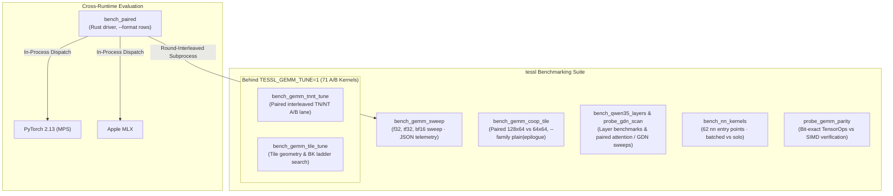

The A/B rig is 71 measurement-only kernels and is **not** in the default
metallib — linking it took the shipped artifact from 0.22 MB to 1.09 MB. Opt in:

`TESSL_GEMM_TUNE` changes what build.rs links, so it goes on **every** `cargo`
command that may rebuild the metallib, `cargo run` included; a plain `cargo run`
after a tune build reruns build.rs without it and drops the tune kernels:

```bash
TESSL_GEMM_TUNE=1 cargo build --release --bins
TESSL_GEMM_TUNE=1 cargo run --release --bin bench_gemm_tile_tune
```

Both tuning binaries `exit(2)` naming their own `TESSL_GEMM_TUNE=1 cargo run`
line when the variants are absent, rather than printing a page of `skip(pipe)` and exiting 0 (they did
the latter until 2026-10-10; `tests/tune_rigs_refuse_missing_variants.rs` pins
the refusal). They check every variant the run will dispatch before timing
anything.

Both time production and every variant of a shape as the arms of one
interleaved A/B (`run_paired` in `src/bin/common/mod.rs`): `BENCH_WARMUP`
untimed calls of each arm, then `BENCH_ROUNDS` rounds (default 6) with the arm
order reversed every other round, `BENCH_ITERS` timed calls per arm per round
(default 5). A variant's ratio is the median of its per-round
production/variant ratios, printed with their range. A shape whose production
arm moved more than 10% across its rounds is flagged `EXCEEDS 10%`, and the
process then exits 3 after printing everything.

## Pitfall 1 — a noise floor wider than the effect

Until 2026-10-10 both tuning rigs timed a baseline block and a variant block
minutes apart, so GPU clock drift landed entirely in the ratio. Run four times,
`bench_gemm_tile_tune` showed the **production kernel measured against
itself** ranging **0.92×–1.46×**, and `bench_gemm_tnnt_tune` timed production
for all its iterations before any variant in exactly the same way, although
this page called it interleaved. The panel-walk gates in
`kernels/matmul_tensorops.metal` quote ratios from that blocked rig.

Any single-run conclusion from those rigs is inside their own noise. Both now
interleave round by round, every arm once per round with the order reversed
every other round, and report the median of the per-round ratios. The paired
lane (`bench_gemm_coop_tile`, both families) does the same, and that
brought their spread to roughly ±5%.

> [!NOTE]
> Both places above named `bench_gemm_coop_ab` until 2026-09-01. No such binary
> exists — the crate builds five, and the paired A/B lane is
> `bench_gemm_tnnt_tune`. A first pass at this corrected only the *Reproducing*
> block at the end of this document and left these two, which is why the note
> there could truthfully say it was fixed while two live references survived.

## Pitfall 2 — a harness that contaminates its own baseline

The A/B harness allocated a fresh output tensor per candidate. Those piled up
across the run, and with nine candidates the **baseline kernel** drifted
0.268 → 0.665 ms *inside a single shape block*. Read naively, that is a 2.5×
candidate win invented entirely by allocation order.

Fixed by allocating once per shape. The harness now also prints its own baseline
spread across rows and flags

```
EXCEEDS 10%: ratios above are not comparable
```

because this failure is otherwise invisible — every number still looks like a
number. One shape (2048×768×768) still trips that guard and is excluded rather
than quoted.

## Pitfall 3 — cross-process drift

Running the Rust sweep once and the Python sweep once, minutes apart, puts all
the drift between them into the ratio. Two back-to-back runs of the *identical*
benchmark disagreed by **16–21% on the PyTorch lane alone** — larger than most
differences being reported.

`bench_paired --format rows:...` (the recipe is under "Paired rounds") alternates the lanes round by round and reports
the median of per-round ratios plus the spread. **Single-run cross-runtime
numbers should not be quoted**, including earlier ones from this project: a
"1.07× ahead of PyTorch on bf16" claim did not survive the paired protocol and
became 1.00×.

```mermaid
sequenceDiagram
    autonumber
    participant Py as bench_paired
    participant Tessl as tessl (subprocess)
    participant MPS as PyTorch MPS
    participant MLX as Apple MLX

    rect rgb(245, 245, 255)
    Note over Py,MLX: Round 1 (Forward Order)
    Py->>Tessl: Run shape ladder (50 iters) -> report median
    Py->>MPS: Run shape ladder (50 iters) -> report median
    Py->>MLX: Run shape ladder (50 iters) -> report median
    end

    Note over Py,MLX: Clock frequency &amp; thermals drift identically across all lanes

    rect rgb(255, 245, 245)
    Note over Py,MLX: Round 2 (Reverse Order)
    Py->>MLX: Run shape ladder (50 iters) -> report median
    Py->>MPS: Run shape ladder (50 iters) -> report median
    Py->>Tessl: Run shape ladder (50 iters) -> report median
    end

    Note over Py: Compute per-round ratio medians &amp; flag spread &gt; 10%
```

## Paired rounds: `bench_paired`

One Rust driver replaced the retired `paired_bins.sh`, `paired_qwen35_step.sh`,
`paired_cross_runtime.py` and `attn_paired.py` scripts (they lived in `bench/`). A lane is
`NAME=COMMAND`, or `NAME:ENV=V,ENV=V=COMMAND` for per-lane environment (an empty
value unsets; quote a value that holds `,` or `=`). `--clean-env` drops every
inherited `BENCH_*`, `TESSL_*`, `METAL_*`, `MTL_*`, `MLX_*`, `PYTORCH_*`, `OMP_*`,
`MKL_*`, `VECLIB_*` and `ACCELERATE_*` variable first, so only what the lane lines
name reaches a lane. Every round runs every lane once, forward on even rounds and
reversed on odd ones; the report is the median per workload and the median of the
per-round ratios against the base lane, with the lowest and highest round beside
it. `--max-spread X` (1 to 1.25) turns a ratio series whose max/min exceeds `X`
into exit 3 with nothing reported.

| replaces | run |
| --- | --- |
| `paired_bins.sh ROUNDS OUT ARGS` with `BENCH_BINS="before=A after=B"` | `bench_paired --format metrics --rounds N --out OUT.json "before=A ARGS" "after=B ARGS"` |
| `paired_qwen35_step.sh ROUNDS OUT T:MID:MODE[:EXTRA]` | `bench_paired --format metrics --rounds N "cfg1:TESSL_MID_COMMIT=3,METAL_RUNTIME_MID_COMMIT==bench_qwen35_train T --step-only --step=T --async EXTRA" "cfg2:..."`. `--step` prints `METRIC train_step_s_t{T}`, `device_peak_gib_t{T}` and `peak_footprint_gb_t{T}` (the process's lifetime peak footprint, the figure `/usr/bin/time -l` printed). Name a frozen build by its path in the command. |
| `paired_cross_runtime.py --lanes torch,mlx` | `bench_paired --format rows:shape,backend,gflops --evidence --clean-env --keys "$LADDER" --compare tensorops-f32:mps-f32 --compare tensorops-tf32:mps-f32 --compare tensorops-bf16:mps-bf16 --compare tensorops-f32:mlx-f32 --compare tensorops-tf32:mlx-f32 --compare tensorops-bf16:mlx-bf16 --out bench/results/gemm_speed_ladder.json "tessl:BENCH_SHAPES=\"$SHAPES\",BENCH_ITERS=30,BENCH_WARMUP=10=target/release/bench_gemm_sweep" "py:BENCH_SHAPES=\"$SHAPES\"=python3 bench/gemm_sweep_mlx.py --lanes torch,mlx --dtypes f32,bf16 --iters 30 --warmup 10"` (`$SHAPES` is the comma list, `$LADDER` the same list as `--keys`). A ratio is tessl GFLOP/s over the other's, so above 1 tessl is faster. |
| `attn_paired.py --impl tessl-decode --batched 1` | `bench_paired --format rows:cfg,runtime,median_ms --require batched=1 --evidence --clean-env --keys "$CFGS" --compare tessl-decode:torch-mps --compare tessl-decode:mlx --out OUT.json "tessl:BENCH_ATTN_CFGS=\"$CFGS\",BENCH_ITERS=20,BENCH_WARMUP=5,BENCH_ATTN_BATCHED=1=target/release/bench_flash_attn" "py:BENCH_ATTN_BATCHED=1=python3 bench/flash_attn_torch_mlx.py --cfgs $CFGS --lanes torch,mlx --iters 20 --warmup 5"`. A ratio is tessl ms over the other's, so above 1 tessl is slower. `--impl tessl|tessl-tiled|tessl-rows` is a different first variant in `--compare`. The decode path is `Tq == 1` only, so `$CFGS` holds the decode configs; the old driver dropped the prefill ones itself, now the caller names them. |

What each script did, and where it went:

| behaviour | now |
| --- | --- |
| Min-of-N over rounds with the max as spread (`paired_bins`, `paired_qwen35_step`) | The JSON keeps `value_min`, `value_max` and `value_all` per lane; the table is the median plus the ratio's `[lo, hi]`. The ratio of medians of rounds replaces the ratio of mins. Two lanes give the same `vs base` column the old `b/a` column was. |
| `ROUNDS >= 1` (`paired_bins`) | `--rounds` is at least 2 (a single round has no spread), at least 4 and even with `--evidence`; digits only, no sign or leading zero. |
| Frozen binaries `BENCH_BINS`, paths with spaces | One lane per binary; quote a path that holds spaces. |
| `/usr/bin/time -l` peak footprint, device peak | `METRIC` lines from `bench_qwen35_train --step`; `bench_embedgemma2`'s JSON extras (`device_peak_mib`, `peak_footprint_mib`, `forwards`) are carried as before. |
| A lane that prints no `METRIC` line fails the run | Same (exit 1), as does a metric a lane stops reporting in a later round. |
| Same shape ladder for both runtimes, never a geomean over part of it | `--keys` names the ladder; a (key, variant) absent from any round is an error naming it. |
| Same batching on both sides (`attn_paired`) | `--require FIELD=VALUE`: a row that lacks the field, or carries another value, is refused. |
| Spread gate per shape and on the per-round geomean, default 1.10, cap 1.25 | `--max-spread`, default 1.10 under `--evidence`; the per-key series and the paired geomean are both gated, and nothing is printed or published when one fails. |
| Inherited tuning knobs cleared | `--clean-env`. |
| Provenance: git revision, dirty flag, diff hash, input hashes, host, power, load, device | `--evidence` writes the same block under `provenance`. The shader hash is the lane executable's hash: the runtime embeds the metallib bytes (`include_bytes!`), where the old driver resolved a metallib path no current binary carries. |
| `--out` published atomically, an `.attempt.json` marker that makes an older output stale | Same; the marker is written before any other option is validated. |
| Non-finite numbers cannot reach the artifact | The renderer refuses them. |
| Artifact fields `peak_gflops`, `schema_version: 2` compatibility keys (`geomean`, `geomean_tessl_over_other`) | Not emitted. Per-key medians of each variant are under `per_key[].a_value` and `b_value`, the canonical aggregate is `paired_geomean`. Old result files keep their old schema. |
| `bench/attn_tune.py` knob sweeps | Unchanged, not replaced: it sweeps knobs through `bench_flash_attn`, it does not pair runtimes. |

`bench/benchmark_evidence.py` shrank to `embedded_metallib_path`, the one helper
`bench/kernel_coverage.py` imports. The helper resolves a path no current binary
embeds (it returns "found []"), which is `kernel_coverage.py`'s to settle.

## Pitfall 4 — stale binaries

`cargo test --lib` rebuilds the library but **not** the binaries. Two rounds of
"the fix isn't working" were a stale `bench_gemm_sweep`. Worse, a conclusion was
drawn from those numbers — that in-kernel register pressure cost ~25% — and it
was never actually tested.

Rebuild binaries explicitly before benchmarking:

```bash
cargo build --release --bins
```

## Pitfall 5 — traversal order

The tune rig used row-major tile traversal while production uses Morton/Z-order
on square power-of-two grids. The control read 0.71–0.88× of production *despite
identical geometry*. A rig must mirror `tile_from_linear`, or every variant is
penalised on square shapes.

Production now also walks a large B in column panels: through `tile_walk`,
every GEMM family (exact f32, the cooperative NN, bf16 TN/NT and their
accumulates, int8) does so once $N \times K \ge 2^{23}$, on any grid not
walked in Morton order. The cooperative NN kernels had their own gate (8-row
panels from 2048 tiles) until 2026-10-11; `bench/results/gemm_panel_walk_m5pro.txt`
is the per-lane A/B that retired it. The rig's base copies of the TN/NT coop
kernels still mirror `tile_from_linear`, so past that gate they stand for the
walk production replaced, not for production. There, compare against the
production line or the matching `_ph` panel variant: `_ph4` for 128-row tiles
and `_ph8` for the 64-row accumulate tiles.

## The dispatch floor

Under this submit-and-wait protocol both tessl and PyTorch sit on a **~0.25 ms
per-GEMM floor**. tessl's wall time is flat from 4 MFLOP to 2416 MFLOP:

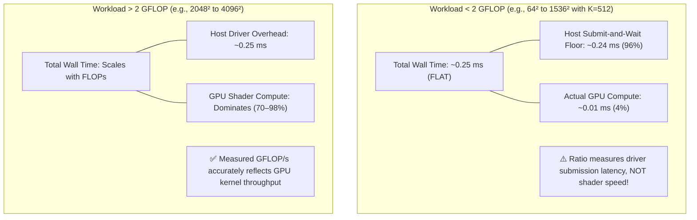

| shape (K=512) | MFLOP | tessl ms | PyTorch ms |
| --- | --- | --- | --- |
| 64×64 | 4 | 0.266 | 0.299 |
| 512×512 | 268 | 0.234 | 0.244 |
| 1536×1536 | 2416 | 0.267 | 0.396 |
| 2048×2048 | 4295 | 0.360 | 0.547 |

A 600× increase in work at constant wall time is not a GEMM measurement. Below
roughly 2 GFLOP these benchmarks measure submit-and-wait latency, so ratios there
— including bf16 `square_512` at 0.84× — say nothing about kernel throughput.
Real workloads batch many dispatches into one command buffer and do not pay this
per-GEMM.

## Reproducing

```bash
# Rust lanes, human table plus JSON to stdout. BENCH_SHAPES overrides the
# built-in ladder; BENCH_WARMUP and BENCH_ITERS default to 10 and 50.
cargo run --release --bin bench_gemm_sweep
BENCH_SHAPES="2048x2048x2048,4096x4096x1024" cargo run --release --bin bench_gemm_sweep

# Paired cross-runtime (needs torch and/or mlx importable; recipe under "Paired rounds")
target/release/bench_paired --format rows:shape,backend,gflops --compare tensorops-f32:mps-f32 \
  --keys 1024x1024x1024 --rounds 6 --clean-env \
  'tessl:BENCH_SHAPES=1024x1024x1024,BENCH_ITERS=30,BENCH_WARMUP=10=target/release/bench_gemm_sweep' \
  'py:BENCH_SHAPES=1024x1024x1024=python3 bench/gemm_sweep_mlx.py --lanes torch --dtypes f32 --iters 30 --warmup 10'

# Tile-geometry and TN/NT A/B lanes. These live behind TESSL_GEMM_TUNE because
# the 71 measurement kernels are excluded from the default metallib; the
# variable goes on each command, or build.rs rebuilds the metallib without them.
TESSL_GEMM_TUNE=1 cargo build --release --bins
TESSL_GEMM_TUNE=1 cargo run --release --bin bench_gemm_tile_tune
TESSL_GEMM_TUNE=1 cargo run --release --bin bench_gemm_tnnt_tune

# Bit-exact parity of TensorOps against the reference SIMD path
cargo run --release --bin probe_gemm_parity
```

> [!NOTE]
> This block previously named a binary `bench_gemm_coop_ab` and an environment
> variable `BENCH_ROUNDS`. Neither existed then; the command failed with "no
> bin target named `bench_gemm_coop_ab`" for anyone who tried it.
> `BENCH_ROUNDS` has existed since 2026-10-10, for the two tuning binaries.

## Measured — M5 Pro, 2026-08-31

`cargo run --release --bin bench_gemm_sweep`, medians over 50 iterations after
10 warmup, single run rather than paired, so treat these as the machine's shape
rather than a cross-runtime claim:

| shape | f32 exact | tf32-relaxed | bf16 | simdgroup f32 |
| --- | ---: | ---: | ---: | ---: |
| 512³ | 796 | 1,284 | 1,358 | 912 |
| 1024³ | 4,167 | 7,291 | 8,410 | 2,380 |
| 2048³ | 6,431 | 13,383 | 21,220 | 2,735 |
| 4096³ | 6,292 | 13,624 | **26,642** | 2,254 |
| qkv_proj (2048×768×768) | 4,262 | 7,639 | 9,209 | 2,348 |
| mlp_up (8192×3072×768) | 6,127 | 16,293 | 24,776 | 2,639 |
| mlp_down (8192×768×3072) | 6,403 | 15,301 | 25,288 | 2,334 |
| tall_k1024 (4096×4096×1024) | 6,180 | 16,096 | 25,126 | 2,732 |

GFLOP/s. Three things in that table are worth reading rather than skimming.

**bf16 TensorOps is 11.8× the portable simdgroup fallback at 4096³** (26,642 vs
2,254) and 4.2× exact f32. That ratio is the entire argument for the
cooperative-destination path.

**At 512³ the simdgroup fallback beats TensorOps f32** — 912 against 796. Not a
regression: at that size the whole GEMM is inside the dispatch floor described
above, so the comparison measures submit-and-wait latency, not the kernels.

**f32 exact flattens at ~6,400 GFLOP/s from 2048³ onward** while bf16 keeps
climbing to 4096³. Exact f32 uses the 32×32 single-simdgroup kernel with no
register accumulator, so it is bandwidth-bound where the cooperative kernels are
not.

## The `nn` kernels — M5 Pro, 2026-08-31

```bash
cargo run --release --bin bench_nn_kernels
```

These kernels are small enough that the dispatch floor above dominates them
entirely. A 1×4096 RMSNorm moves 32 KB; issued alone with a `synchronize()` it
reports ~620 µs, which is the driver, not the shader. So each kernel is timed
twice and both columns are printed:

* **batched** — `set_async_encode(true)`, 64 dispatches accumulated into one
  command buffer, one `synchronize()`, divided by 64. What a decode loop pays.
* **solo** — `set_async_encode(false)`, one dispatch, one synchronize.

`async_encode` defaults to **off**, so the solo column is what a caller gets
without asking for anything. The gap between the columns is what the packed
encode path is worth, and at `mlp_silu n=4096` it is 4.1 µs against 203 µs —
**49×**.

| kernel | shape | batched µs | solo µs | GB/s |
| --- | ---: | ---: | ---: | ---: |
| `rms_norm_f32` | 1×4096 | 24.2 | 388.6 | 2.0 |
| `rms_norm_f32` | 512×4096 | 55.1 | 254.5 | 305.0 |
| `rms_norm_f32` | 2048×4096 | 310.5 | 512.7 | 216.2 |
| `mlp_silu` | n=4096 | 4.1 | 203.2 | 11.9 |
| `mlp_gelu_tanh` | n=4096 | 4.0 | 199.7 | 12.2 |
| `mlp_silu` | n=1M | 30.0 | 213.0 | 419.2 |
| `mlp_gelu_tanh` | n=1M | 30.9 | 216.4 | 406.7 |
| `mlp_silu` | n=8M | 440.1 | 582.4 | 228.8 |
| `softmax_rows_f32` | 512×4096 | 79.8 | 259.2 | 210.4 |
| `softmax_rows_f32` | 2048×8192 | 588.2 | 796.2 | 228.2 |
| `row_sum_f32` | 2048×8192 | 276.3 | 502.9 | **242.9** |
| `row_max_f32` | 2048×8192 | 277.7 | 435.3 | 241.7 |
| `gemv_q8` | 4096×4096 | 95.8 | 259.2 | 197.4 |
| `gemv_q4` [row] | 4096×4096 | 81.6 | 261.9 | 128.8 |
| `gemv_q4` [tiled] | 4096×4096 | 131.8 | 305.1 | 79.8 |
| `gemv_q8` | 11008×4096 | 307.9 | 786.8 | 164.9 |
| `gemm_i8_dequant` | 512³ | 18.9 | 210.6 | — |
| `gemm_i8_dequant` | 2048³ | 343.4 | 526.7 | — |

The two integer GEMMs are compute-bound rather than bandwidth-bound: 14,221 and
**50,032 GFLOP/s**. The latter is 1.9× the bf16 TensorOps peak in the table
above, which is the expected shape for int8 on these accelerators.

The `n=1M` row at 419 GB/s is the honest ceiling estimate for this machine —
above it the working set stops fitting and `n=8M` settles at 229 GB/s, which is
where the large reductions also land. Read ~240 GB/s as "saturating memory" for
these shapes.

### RMSNorm was one thread per row — fixed 2026-08-31

This benchmark's first run found `rms_norm_f32` peaking at **87 GB/s** where
`row_sum_f32` reached **243 GB/s** on identical traffic, and taking 404 µs to
move 32 KB at 1×4096.

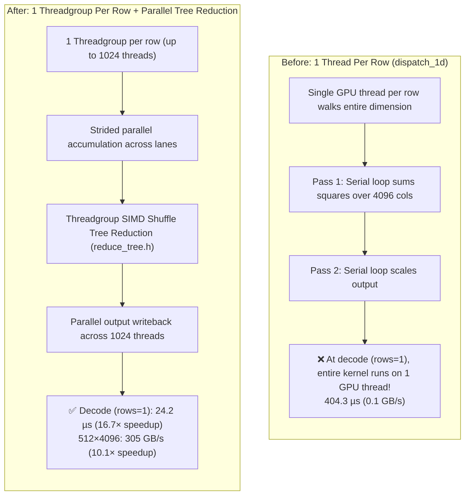

Not an artifact. The kernel's own first line said "One thread per row", and
`dispatch_1d(rt, &p, rows)` launched exactly `rows` threads, each walking its
row serially twice — once to accumulate the sum of squares, once to scale. At
the decode shape `rows = 1`, so the whole kernel ran on a single GPU thread.
RMSNorm runs twice per transformer layer on every token, making decode the worst
point on that curve.

All three variants — `rms_norm_f32`, `rms_norm_bf16`,
`rms_norm_residual_add_f32` — now use one threadgroup per row with the sum of
squares reduced as a tree, which is the pattern `reduce.metal` already used:

| shape | before | after | speedup | GB/s before → after |
| --- | ---: | ---: | ---: | --- |
| 1×4096 (decode) | 404.3 µs | **24.2 µs** | **16.7×** | 0.1 → 2.0 |
| 512×4096 | 556.2 µs | **55.1 µs** | **10.1×** | 30.2 → 305.0 |
| 2048×4096 | 770.7 µs | **310.5 µs** | **2.5×** | 87.1 → 216.2 |

The 512×4096 case now reaches 305 GB/s, above the large reductions, because its
working set still fits cache where a 2048-row sweep does not.

The reduction reassociates where the serial loop did not, so results differ in
the low bits. That is why the new tests compare against an f64 reference rather
than a matching f32 accumulation — the old `rms_norm_ref` summed in f32 in the
same order the serial kernel did, which agreed with the kernel's rounding
instead of measuring it.

Two things this exposed beyond the kernel itself. The existing tests used `dim`
of 16 to 64, and `reduce_tptg` hands a 4096-wide row 1024 threads, so every
lane's strided loop ran exactly once — **deleting the loop entirely left all
three tests green**. `rms_norm_sums_rows_wider_than_one_threadgroup` and its
sibling now cover 4096, a ragged 3000, and 8192, and both kill that mutation.
And `REDUCE_TREE` moved into `kernels/reduce_tree.h` so the two callers share
one definition; `build.rs` had to start tracking `.h` for `rerun-if-changed`,
without which editing the shared reduction would leave both dependents stale in
the metallib while the tests reported a pass.

### Q8 GEMV had the same defect, plus one of its own — fixed 2026-08-31

`gemv_q8` was also one thread per row, and for a kernel whose entire cost is
streaming weights that was wrong twice over. Parallelism was capped at `rows`,
and adjacent threads read addresses `cols` bytes apart, so a simdgroup's 32
loads touched 32 different cache lines and nothing coalesced.

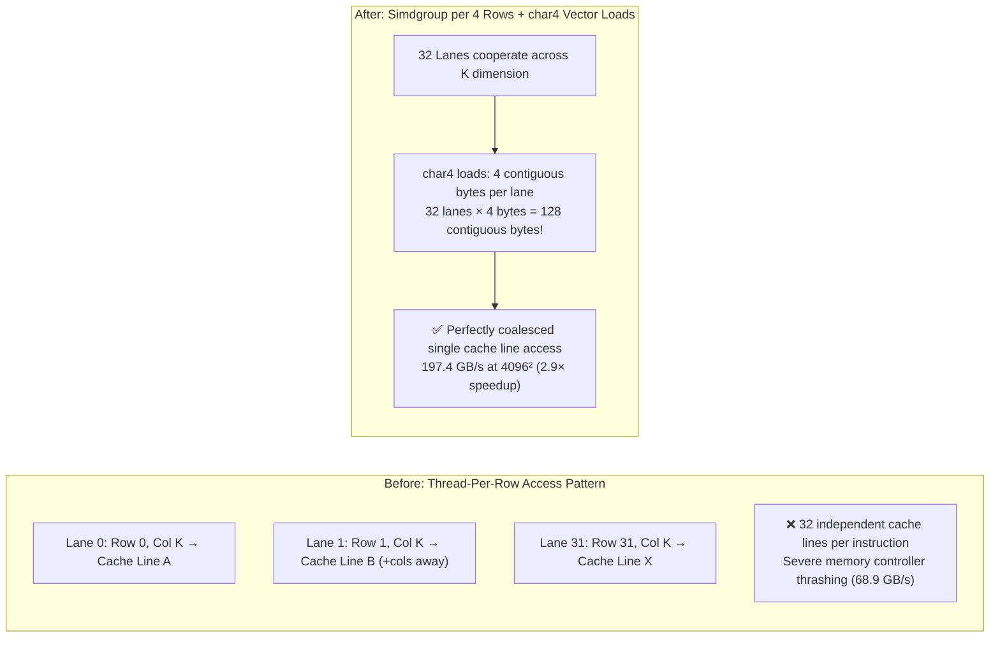

It now uses one simdgroup per four output rows with lanes striding K — the
geometry the MLX Q4 simd GEMVs already used, reusing the existing
`simd_gemv_threadgroups` and `SIMD_TPTG` host helpers rather than inventing a
second convention. Lanes take four bytes each through a `char4` load, so a
simdgroup covers 128 contiguous bytes per instruction instead of 32.

| shape | before | after | speedup | GB/s before → after |
| --- | ---: | ---: | ---: | --- |
| 4096×4096 | 274.5 µs | **95.8 µs** | **2.9×** | 68.9 → 197.4 |
| 11008×4096 | 383.6 µs | **307.9 µs** | **1.25×** | 132.4 → 164.9 |

The tall case gains least and is the honest limit of this change. Vectorising to
`char4` moved 4096² from 161.6 to 197.4 GB/s but left 11008×4096 flat at ~163,
so that shape is bound by something the access pattern does not control —
plausibly the 5.6 MB of scale/zero pairs it also streams, which are read
uniformly by all 32 lanes of a simdgroup. Recorded as measured rather than
explained away; the next thing to try is loading them once per simdgroup.

The `char4` path needs `group_size % 4 == 0`, so a scalar fallback stays for
other group widths. Both paths and the ragged row tail are covered by
`gemv_q8_covers_the_row_tail_and_the_scalar_fallback` — the pre-existing test
used rows = 24 and group = 16, a multiple of the 8 rows a threadgroup owns and a
group width divisible by four, so it exercised neither. Verified: forcing
`xv = 0` in the fallback and removing the `row < rows` writeback guard both left
it green. The new test seeds `y` past `rows` with a sentinel, because a tail
threadgroup writing rows it does not own is otherwise invisible.

### The sweep that found a correctness bug — 2026-08-31

After RMSNorm and Q8 GEMV, the remaining `dispatch_1d` call sites in `src/nn.rs`
were swept for the same shape: a thread per *row* with a serial loop inside,
rather than a thread per element.

Seven were clean. `mlp_silu`, `mlp_gelu_tanh`, `mlp_gelu_tanh_bf16`,
`scale_f32_inplace`, `kv_store_timestep`, `kv_ring_densify`, `softcap_logits`
and `embed_lookup_q4` are genuinely elementwise — zero inner loops — so one
thread per element is the right grid.

The MLX Q4 row variants (`gemv_q4_mlx`, `_wide`, `_tiled`) are one thread per
row deliberately: they take an **f32** activation vector, and their own doc
comment points at `gemv_q4_mlx_simd` for the bandwidth-limited decode shape,
which reads bf16 and halves the traffic. A faster sibling already exists; these
are a different input contract, not an oversight.

`gemv_q4` was the one left, and benchmarking it turned up something worse than a
slow kernel:

| shape | `[row]` | `[tiled]` before fix | `[tiled]` after fix |
| --- | ---: | ---: | ---: |
| 4096×4096 | 128.8 GB/s | *3,077 GB/s* | 79.8 GB/s |
| 11008×4096 | 143.9 GB/s | *1,217 GB/s* | 81.6 GB/s |

3,077 GB/s is not a number this machine can produce, and that is the whole tell.
`gemv_q4_tiled` indexes its output row by `threadgroup_position_in_grid`, so it
needs one threadgroup per row; it was being dispatched with
`rows.div_ceil(128)` groups — the geometry the *other* kernel needs. It wrote
the first `rows / 128` rows and left the rest of `y` untouched. No error, no
partial-write signal, just whatever was in the buffer before.

Measured directly: at 512 rows, `nn::gemv_q4(.., tiled = true)` wrote **4 rows
and left 508** holding their sentinel.

Nothing caught it. `promoted_kernels.rs` checks the pipeline name exists;
`nn_adversarial.rs` checks the error paths; neither runs the kernel for a
number. `gemv_q4_tiled_writes_every_row_and_agrees_with_the_row_kernel` now
does, at 512×256 and a ragged 300×128, seeding `y` per variant so the row
kernel's output cannot mask what the tiled one failed to write.

With the grid corrected, the tiled variant is **slower** than the row variant at
both shapes. Its apparent speed was entirely the work it was skipping.

This benchmark's own check was too weak to catch it: it required only that
*some* output element be non-zero, and 4 correct rows satisfied that. It now
seeds every output with a sentinel immediately before the kernel runs and fails
if any live element survives — verified by re-breaking the dispatch, which
reports "4064 of 4096 output elements were never written (first at 32)". Seeding
per call rather than per allocation matters: the two `gemv_q4` arms share one
`y`, and a buffer seeded once would be filled by the first arm before the second
was checked.

## Measured — tessl against PyTorch MPS, M5 Pro

`bench_paired --format rows:shape,backend,gflops` (the `paired_cross_runtime.py` driver that produced these files was replaced by it; see "Paired rounds"), alternating the
lanes round by round per the protocol above. Raw data:
`bench/results/gemm_speed_ladder_m5pro.json` (run 1, top panel),
`gemm_speed_ladder_m5pro_b.json` (run 2) and
`gemm_speed_bf16_confirm_m5pro.json` (9 rounds, bf16 only). These three files
were imported from the MLSystemsLab copy of this crate (see
[Provenance of `bench/results/`](#provenance-of-benchresults)): they are that
copy's measurements, not a run of this tree's kernels.

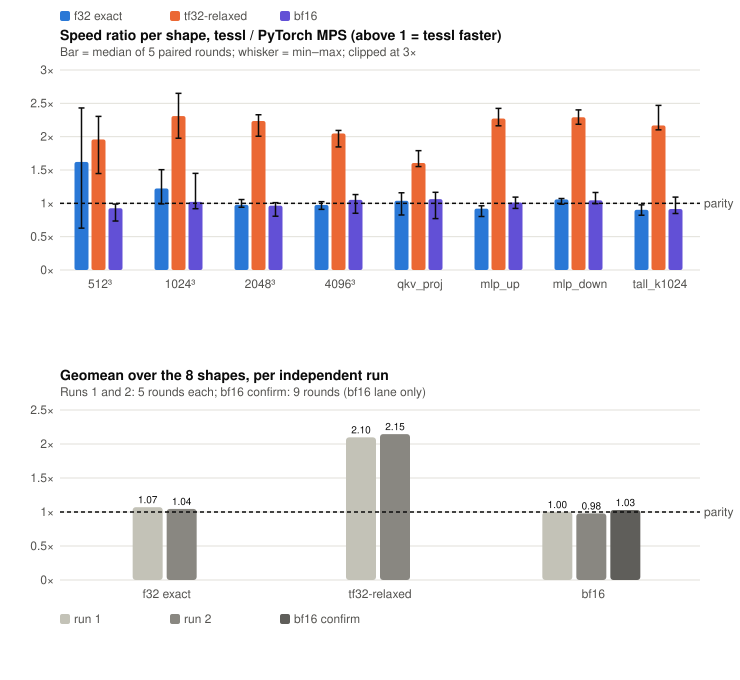

- **bf16 is at parity with PyTorch** — geomean 0.98–1.03× across three
  independent runs, with per-shape medians between 0.86× and 1.34×.
- **Exact f32 is within noise of parity** (1.04–1.07× geomean). The 512³ and
  1024³ bars sit above 1× but their ranges reach below it: that size is inside
  the dispatch floor, so it measures submit latency, not the kernel.
- **tf32-relaxed is ~2.1× PyTorch's f32**, but the numerics differ. PyTorch's
  f32 lane is full precision; this lane trades mantissa bits, so it is not a
  like-for-like win.

The attention files store a time ratio (`tessl_ms / other_ms`,
the retired `attn_paired.py`), the inverse of this axis. They are imported and
their ratios are not quoted here (see Attention below).

## Measured — step-waste and dispatch host-overhead, M5 Pro, 2026-10-08

Paired before/after runs, one process per binary per round with order reversed
on odd rounds. Both ran on a shared machine (load average 10–33), so only the
min-of-N figures are comparable. Raw output and conditions:
`bench/results/qwen35_train_step_{before,after}_m5pro.txt` and
`bench/results/dispatch_host_overhead_{before,after}_m5pro.txt`.

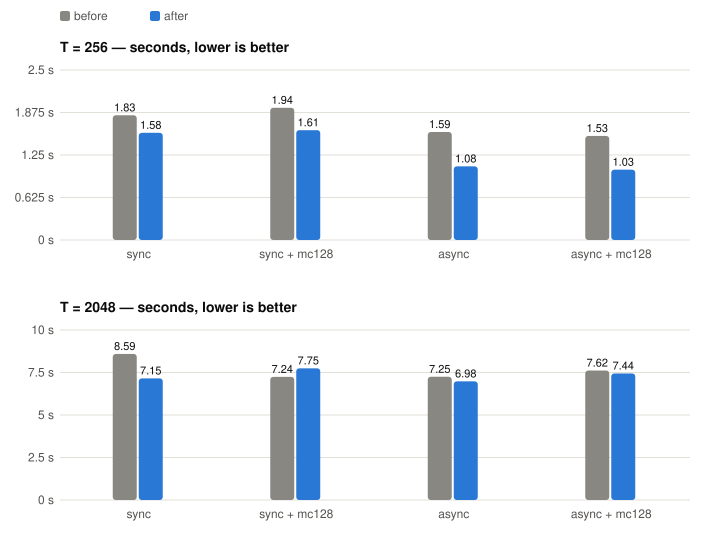

Min of 3 rounds, each a median of 3 steps. `mc128` is `TESSL_MID_COMMIT=128`.
`2048:128:sync` is the one config that is slower after (7.746 s against
7.244 s); its rounds span 7.2–8.4 s before and 7.7–9.3 s after, inside the
noise at this load. Peak device memory is equal or lower everywhere.

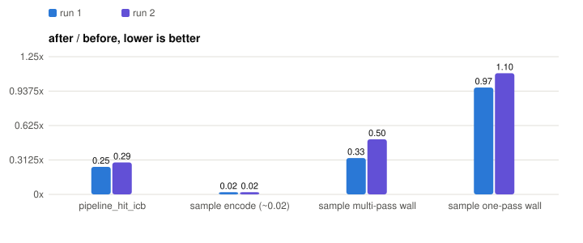

Two back-to-back runs. The sampler no longer synchronizes (encode ~0.02x) and
multi-pass sampling drains once per token instead of once per pass. The
one-pass sampler is GPU-bound and unchanged. Per-token decode is GPU-bound too
(wall 0.998x), so no decode speedup is claimed; the change there is structural.
The sampler encode ratio is plotted at the file's "~0.02", not a per-run
measurement.

### Wave 2, 2026-10-10

`bench/results/qwen35_train_step_wave2_m5pro.txt` pairs main (d57f4f7) with
the wave-2 build (c5fd930) the same way, adding bf16 storage
(`--storage=bf16`, a step into a bf16 bank) and a clipped optimizer step on
it; load average 2–13. On bf16 storage the device peak is 1.9 GiB lower at
the same step time; on f32 storage T = 2048 is 2% faster and 1 GiB lower,
and T = 256 the same time but 1 GiB higher (the pool now caches the step's
own buffers, see the file). `grad_sq_norm` falls from 320 waits to 1 and
from 660–770 ms to 41–56 ms; the clipped step from 2.19–2.23 s to
1.54–1.69 s under sync encode. `adamw_step` reads higher there without
being slower, which the file traces. The file also records a first run that
showed a bf16 regression and its cause, the pool cache pinned by the
loader's staging tensor (fixed in b8d4010).
`bench/results/qwen35_4b_storage_memory_wave2_m5pro.txt` is the 4B step's
peak over resident to the byte (`probe_storage_memory --no-optimizer`):
5.76 → 3.35 GiB at T = 2048, more than the 2.37 GiB f32 head gradient a
bf16 bank no longer allocates.

## Provenance of `bench/results/`

29 of the files in `bench/results/` came from the MLSystemsLab nested copy of
this crate (commit `6c62ab7`, merged as "nested-only files" in `ff0d954`) and
were measured on that copy's code, which differs from this tree: for example
`SPLITK_MIN_K` and `splitk_gate_opens_at_the_measured_depth` do not exist here,
and the attention kernels differ between the copies. They are listed in
[`bench/results/PROVENANCE.md`](../bench/results/PROVENANCE.md). Wherever this
document presents one of them, it says "imported".

## Every recorded result, plotted

One figure per family of files in `bench/results/`. Blue always means the new
or tessl side is faster; red means slower; bars on a log axis start at 1×.
Ratios from the A/B notes are the notes' own paired, order-balanced medians.

### GEMM

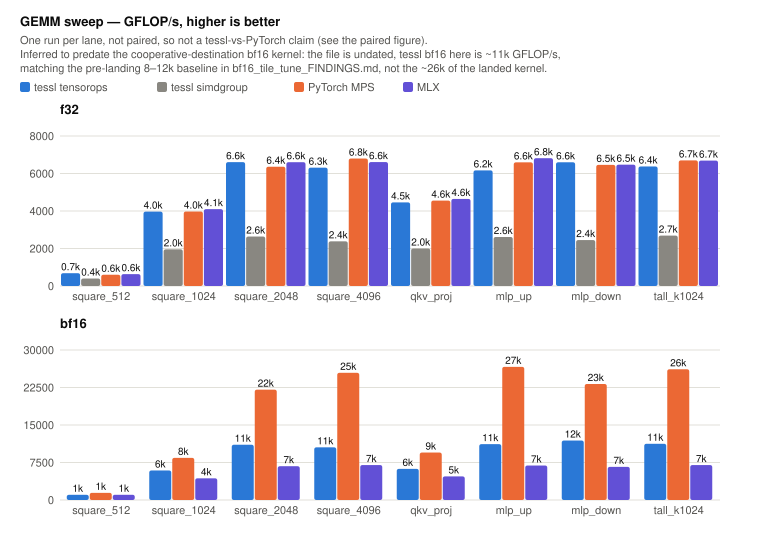

`gemm_sweep_m5pro_f32_bf16.json`. One unpaired run per lane. The file is
undated; its tessl bf16 is ~11k GFLOP/s at 4096³ against PyTorch's ~25k, which
matches the pre-landing baseline in `bf16_tile_tune_FINDINGS.md` and not the
26.6k of the landed cooperative-destination kernel in the table above. Treat
the bf16 panel as history (inferred, not stated in the file). The paired
figure above is the current comparison.

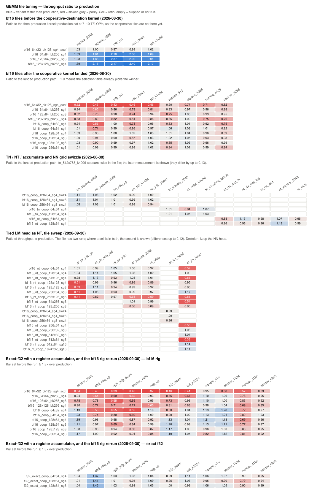

`bf16_tile_tune_m5pro.txt`, `bf16_tile_tune_m5pro_coop.txt`,
`bf16_tnnt_coop_m5pro.txt`, `bf16_nt_lm_head_m5pro.txt` and
`f32_exact_coop_m5pro.txt`. Before the cooperative kernel the best tiles beat
production by up to 2.4×; after it, the best variant for each shape is 0.99–1.06×
production and 94% of the non-cooperative variants are below 1× (0.43–1.05×),
so the selection table already picks the winner. Where a file measures the same
shape twice (`bf16_tnnt_coop`, `bf16_nt_lm_head`), the grid shows the later
measurement; repeats differ by up to 0.13. The exact-f32 register
accumulator misses its ≥ 1.3× bar except on the 2B's MLP-up shape
(1.37–1.45×), and the NT head variants are 5–11% slower than the NN head, so
neither shipped.

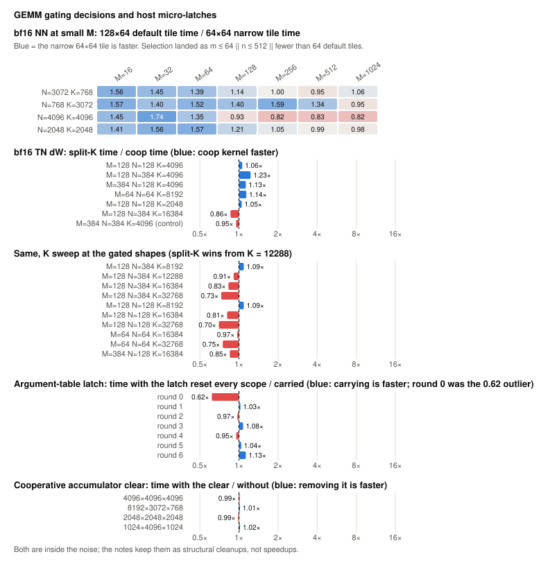

`bf16_smallm_coop_m5pro.txt`, `splitk_gate_m5pro.txt`,
`arg_table_latch_m5pro.txt` and `coop_clear_m5pro.txt` (all four imported:
measured on the MLSystemsLab copy). The narrow tile wins
at small M and loses once the grid fills; split-K wins from K = 12288. The
first two were measured on the MLSystemsLab copy of this crate and
re-measured on tessl's kernels with their method on 2026-10-11
(`bf16_smallm_coop_reconciled_m5pro.txt`, `splitk_par_bf16_m5pro.txt`): the
grid-fill rule held and was ported for bf16; a parallel bf16 split-K beat
both arms of the split-K gate and replaced the sequential lane. The
latch and accumulator-clear changes are inside the noise and are kept as
cleanups, not speedups.

### Kernels

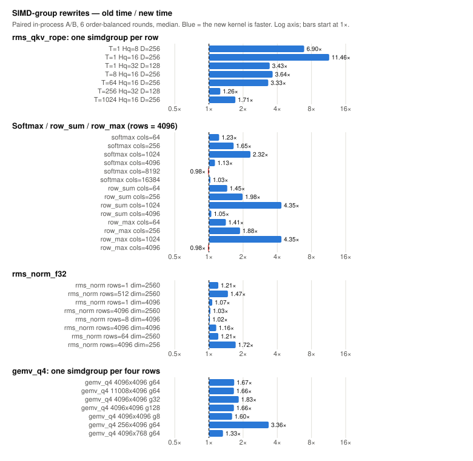

`rope_simdgroup_m5pro.txt`, `row_reduction_simd_m5pro.txt` and
`gemv_q4_simd_m5pro.txt` (all three imported: measured on the MLSystemsLab
copy, not re-run on this tree). Latency-bound shapes gain most (rope 3.3–11.5× at
decode and small T, row_sum 4.35× at 1024 columns); bandwidth-bound shapes
(softmax at 8192 columns, 0.98×) do not move.

### Attention

The `attn_speed_*.json` files (imported: measured on the MLSystemsLab copy,
whose attention kernels differ from this tree's) hold tessl-against-PyTorch-MPS
and tessl-against-MLX attention timings. No attention ratio against MLX or
PyTorch is quoted here, and their two figures (`img/attention_speed_history.svg`,
`img/attention_speed_per_config.svg`) are not embedded, because those ratios are
unverified for this tree. They become quotable when the attention ladder is
re-run on this tree with `bench_paired` (recipe under "Paired rounds").

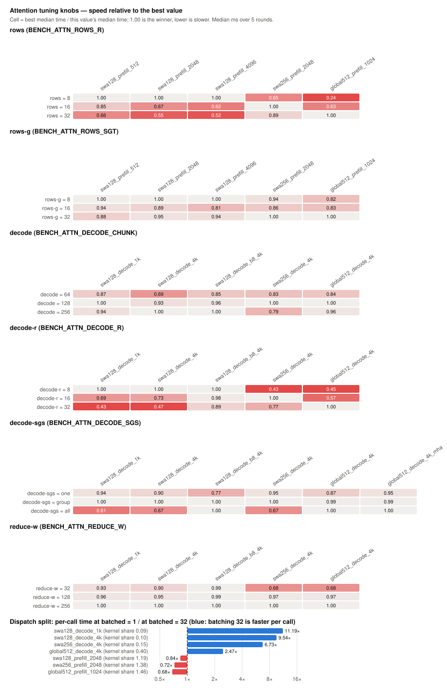

`attn_tune_*.json` and `attn_dispatch_split_m5pro.json` (imported: knob sweeps
on the MLSystemsLab copy). The best value of each
knob differs by configuration, which is why they are selected per shape rather
than fixed. Batching 32 calls per command buffer cuts per-call decode time by
up to 11×, while prefill gets slower per call.

### Qwen3.5 and dispatch

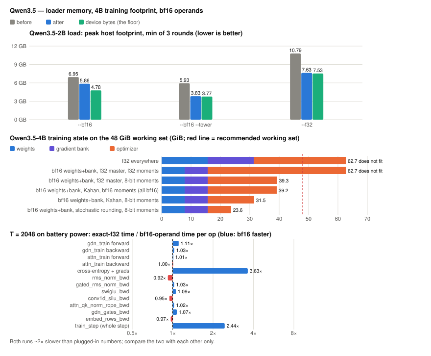

`qwen35_load_rss_m5pro.txt`, `qwen35_4b_storage_memory_m5pro.txt` and
`qwen35_train_step_bf16_m5pro.txt`. The streaming loader cuts peak host
footprint by 1.09 / 2.10 / 3.16 GB (bf16 / bf16 tower / f32). The tower and f32
paths land within 0.06–0.10 GB of the device bytes; bf16 with the LM head keeps
one 1.02 GB host copy of the embedding. On the 4B, the two variants with f32
moments do not fit the 48 GiB working set and the other four do. bf16
GEMM operands run the 2B train step 2.44× faster (cross-entropy 3.63×); that pair
was recorded on battery, so compare the two with each other only.

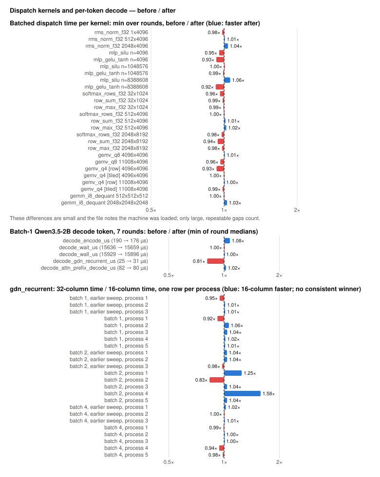

`dispatch_host_overhead_*`, `qwen35_decode_token_*`. Per-kernel batched times
move by 8% at most, and the decode token is unchanged (wall 1.00×): decode is
GPU-bound. The 16- versus 32-column GDN recurrence has no consistent winner.
The per-step training and host-path results are in the section above.

### Accuracy

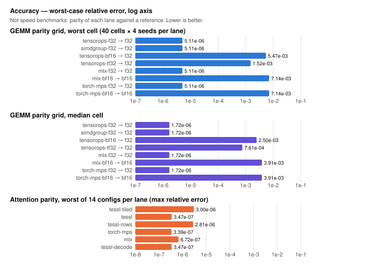

`gemm_parity_grid_m5pro.json` and `attn_parity_m5pro.json` (both imported).
Parity against a
reference, not speed. Exact f32 lanes agree to ~5e-6 worst case across tessl,
MLX and PyTorch alike (identical at 5.11e-06); bf16 lanes to 5e-3–7e-3, and the
tf32-relaxed lane sits between at 1.5e-3.

### Not plotted

- `gemm_align_probe_m5pro.txt` (264 pass/fail runs, all bit-identical),
  `kernel_coverage_m5pro.json` (imported; 147 entry points covered, none
missing, on the MLSystemsLab copy) and
  `fp_contract.txt` (single-shot, "noise, not a speedup") are correctness
  checks or one-run notes, not benchmarks.
- `qwen35_train_step_before_m5pro.txt`, `qwen35_decode_token_before_m5pro.txt`
  and `dispatch_host_overhead_before_m5pro.txt` are the before-only halves of
  the paired files that are plotted above.
- `bf16_tile_tune_FINDINGS.md` is prose.

Every table in this repository is reproducible with the commands above, on an
M5 Pro. On different silicon expect different constants — see Status in the
README.
